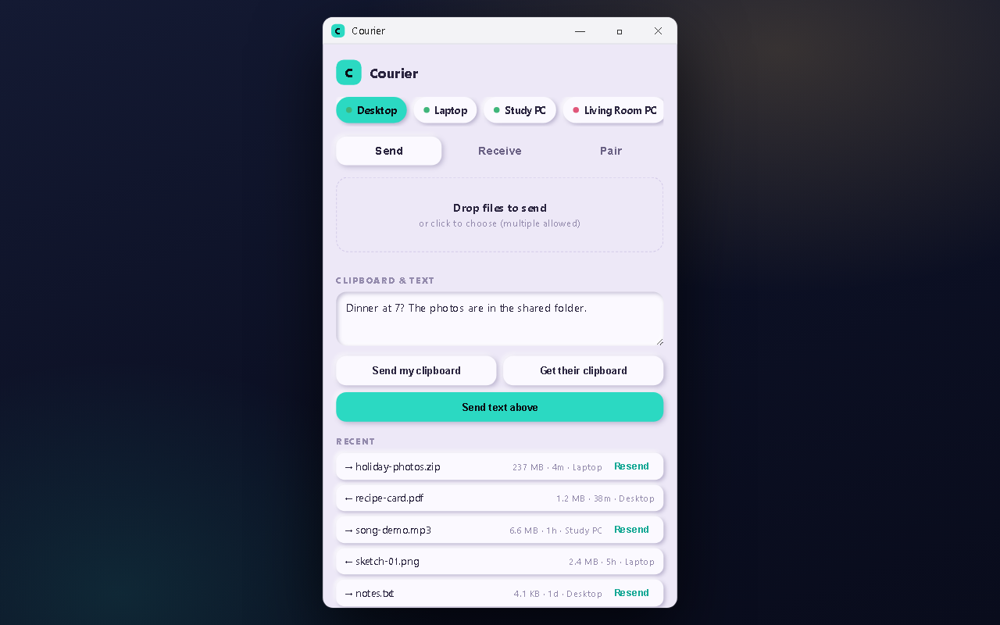
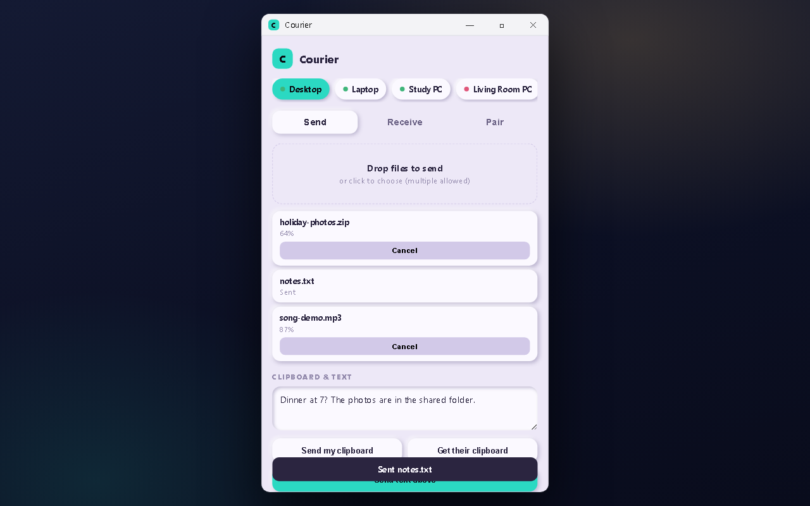
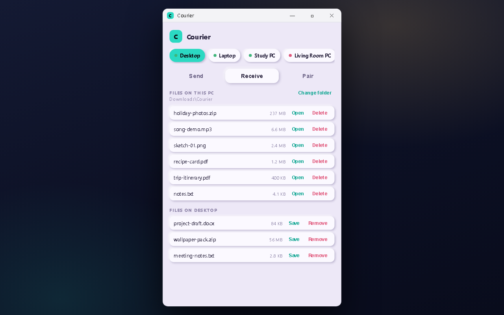

# Courier

**Send text, the clipboard and files between your own devices over your own Wi-Fi: no cloud, no account.**

Pair as many PCs as you want (a desktop, a laptop, a second laptop): each one is a **stop**. Phone → PC and
PC → phone both work directly; phone → phone and PC → PC route through a stop both devices already trust, since a
phone can't run the receiving side itself (yet).

<p align="center">
  
  
  
</p>

<sub>The screenshots show made-up files and device names.</sub>

## What it does

- **Files, text and the clipboard** go straight from one device to another over your home network. Nothing is
  uploaded to a server.
- **Several PCs at once.** Every PC you pair becomes a chip with a live online/offline dot.
- **Desktop app** (Windows, macOS, Linux) with a tray icon, multi-file sends with per-file cancel and retry,
  duplicate handling, a transfer history with resend, a choosable download folder and a notification when a file lands.
- **Send with Courier** in the Windows right-click menu.
- **Phone app** (Android) with QR pairing, a Receive tab, and progress, speed and time left while sending.
- **No install on the sending side** if you don't want one: open `http://<pc-ip>:<port>/pair` in any browser on the
  same Wi-Fi and drop a file on it.
- **Encrypted between PCs** with a certificate pinned when you pair (see [Encryption](#encryption)).

## Install

On Windows, paste this into PowerShell:

```
irm github.com/Shamilimanuel/Courier/raw/main/setup.ps1 | iex
```

It opens the Courier setup window. On the phone, download the newest Android app from the
[Releases page](https://github.com/Shamilimanuel/Courier/releases/latest). More ways to run it (by hand, from source, a
text-only agent) are under [Running it](#running-it).

## Layout

```
Courier/
├── agent/     Node/Express server that runs on each PC — a "stop"
├── app/       Expo React Native app (Android)
├── desktop/   Electron tray app (Windows/macOS/Linux) — the agent, plus a
│              window that lets the PC pair with and send to other stops
└── setup.ps1  one-line installer for the agent, fetched live from main
```

## Running it

**Fastest: one command** (Windows)

In PowerShell on the PC you want to turn into a stop:

```
irm github.com/Shamilimanuel/Courier/raw/main/setup.ps1 | iex
```

Opens the Courier setup window (made like Reveille's): get the phone app,
install the desktop app from the newest release, quietly and just for you
(no administrator rights), and pair. Without a desktop, or with `-Console`,
it is the same in text. After that, `courier` in PowerShell,
cmd or Win+R opens the window; running the line again (or `courier -Setup`)
gives a menu to update, open or remove it. A PC that had the older
window-less agent keeps its pairing token. That agent is still available:
`& ([scriptblock]::Create((irm github.com/Shamilimanuel/Courier/raw/main/setup.ps1))) -Agent`
installs Node if needed, starts it hidden at login and prints a QR code.

**Or by hand**

```
cd agent
npm install
npm start
```

This prints the port and a pairing token (also written to `agent/config.json`,
which is gitignored — it's unique per install). To see the pairing code
again later: `npm run pair`.

**From any browser, no install at all**

Open `http://<pc-ip>:<port>/pair` on any device on the same Wi-Fi — it shows
the same QR/pairing details, and also lets you push a file to that PC
straight from the browser (drag-and-drop, no app needed on the sending
side). This is how PC → PC works today.

**Or the desktop app (Windows, recommended over the headless agent)**

```
cd desktop
npm install
npm start
```

A tray icon replaces the headless agent — same pairing token if one's
already installed, so nothing already paired needs to re-pair. The window
adds what the headless agent alone can't do: pick another stop and send
it a file, your clipboard, or text, right from this PC. On Windows it also
picks up a right-click **Send with Courier** entry in Explorer; every
platform gets a system notification when a file lands and a choosable
download folder. `npm run dist` builds an installer for whichever OS you
run it on; pushing to `main` under `desktop/**` builds and publishes all
three (Windows/macOS/Linux) automatically (see Status below).

macOS/Linux builds are unsigned for now — first launch on macOS needs
right-click → Open (or `xattr -cr Courier.app` in Terminal) to get past
the "unidentified developer" warning, the same one-time step any unsigned
Mac app needs.

**Run the phone app**

```
cd app
npm install
npx expo start
```

Open it in Expo Go on your Android phone (same Wi-Fi network as the PC), and
scan the QR code or enter the address/port/token by hand. Use **+ Add a
stop** on Home to pair additional PCs — each shows up as a chip you can
switch between, with a live online/offline dot. The **Receive** tab lists
whatever's waiting on the current stop, for any other device to pick up.

## Encryption

Every agent generates a self-signed cert the moment it generates its
pairing token, and runs a second, HTTPS listener one port up from the
usual one (`5544` stays plain HTTP, `5545` is pinned HTTPS). There's no
CA — trust comes from the cert's fingerprint riding along in the pairing
QR (or a one-time probe on manual entry, the same way SSH trusts a new
host's key the first time), not from chain validation. The desktop app
already pairs and talks over the pinned HTTPS port automatically; the
phone app still talks the original plain HTTP for now, since verifying a
pinned self-signed cert on Android needs a native module Expo Go can't
load — that's coming with true phone-to-phone support. Nothing currently
paired breaks: the plain port keeps working exactly as before.

## Building a release APK

Pushing to `main` with changes under `app/**` triggers
`.github/workflows/android.yml`, which builds a signed APK and publishes it
as a GitHub Release. The signing keystore lives in `secrets/` (gitignored,
kept off GitHub, with a backup) and in GitHub's encrypted secrets — see
`secrets/READ-ME-FIRST.txt`. **Losing every copy means never being able to
update the installed app again.**

## Status

- [x] PC agent: health check, paired auth (Bearer token), clipboard get/set,
      file upload/list/download with duplicate handling
- [x] Phone app: multi-stop pairing, clipboard/text sync, file/media/app
      send with progress/speed/ETA, and a Receive tab to pull files back down
- [x] Cross-device relay: any two devices paired to the same stop can hand
      files off through it (phone↔phone, PC↔PC), without a phone needing to
      run a server itself
- [x] QR pairing that works from any camera app, not just Courier's own —
      falls back to a download link if the app isn't installed
- [x] Browser-based sending (`/pair` page) — no install needed on the PC
      that's sending
- [x] One-line agent installer, auto-start at login
- [x] Android build pipeline (GitHub Actions → signed APK → Release)
- [x] Desktop tray app (Windows/macOS/Linux): this PC as a stop, plus a
      window to pair with and send to other stops — multi-file sends with
      per-item cancel/retry and duplicate resolution, transfer history
      with resend, browsing and saving files held by another stop, an
      in-app update check, a notification on receipt, and a choosable
      download folder (Explorer "Send with Courier" is Windows-only)
- [x] Desktop build pipeline (GitHub Actions → installer → Release, all
      three OSes; macOS/Linux ship unsigned for now)
- [x] Pinned HTTPS between agents/desktop (self-signed cert, fingerprint
      pinned at pairing — no CA, no scary browser prompt for paired apps)
- [ ] The same pinned HTTPS for the phone app — needs a native TLS-pinning
      module, landing together with true phone-to-phone below
- [ ] True resume for an interrupted file transfer (currently a clean retry,
      not a byte-offset resume)
- [ ] Phone → PC via the Android share sheet ("Send to my PC" from any app)
- [ ] True phone-to-phone without a PC in the middle — the phone hosting
      its own server, foreground service + native TCP module, opt-in
      (bigger lift, in progress)
- [ ] Automatic device discovery (mDNS) — pairing is still QR/manual-IP only

## Privacy

- Courier has **no account and no server of its own**. Your devices talk to each other on your network; nothing is
  sent to the developer or to any cloud.
- Each PC makes its **own pairing token** the first time it starts (it is stored in `agent/config.json`, which is
  gitignored). Every install is independent. Sending, receiving and the clipboard all need that token.
- **Honest limit:** the browser pairing page (`/pair`) is open to anyone on the same Wi-Fi and shows the token, so
  Courier is meant for a home or other network you trust. Don't run it on a public or shared Wi-Fi.
- Between PCs the traffic is HTTPS with a pinned certificate; the phone app still uses plain HTTP on your Wi-Fi for
  now (see [Encryption](#encryption)).
- Files you receive land in the download folder you chose on that PC.

## Licence

[MIT](LICENSE). Use it, change it, ship it; just keep the copyright line.

More projects: https://github.com/Shamilimanuel
